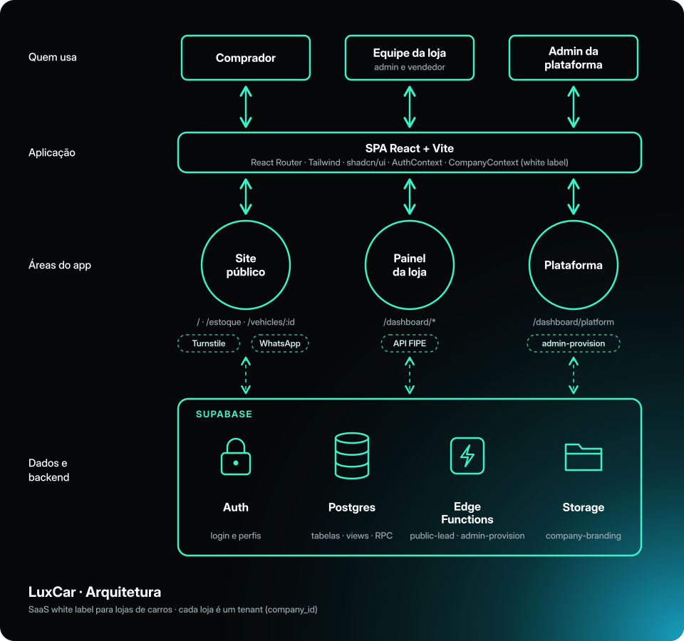
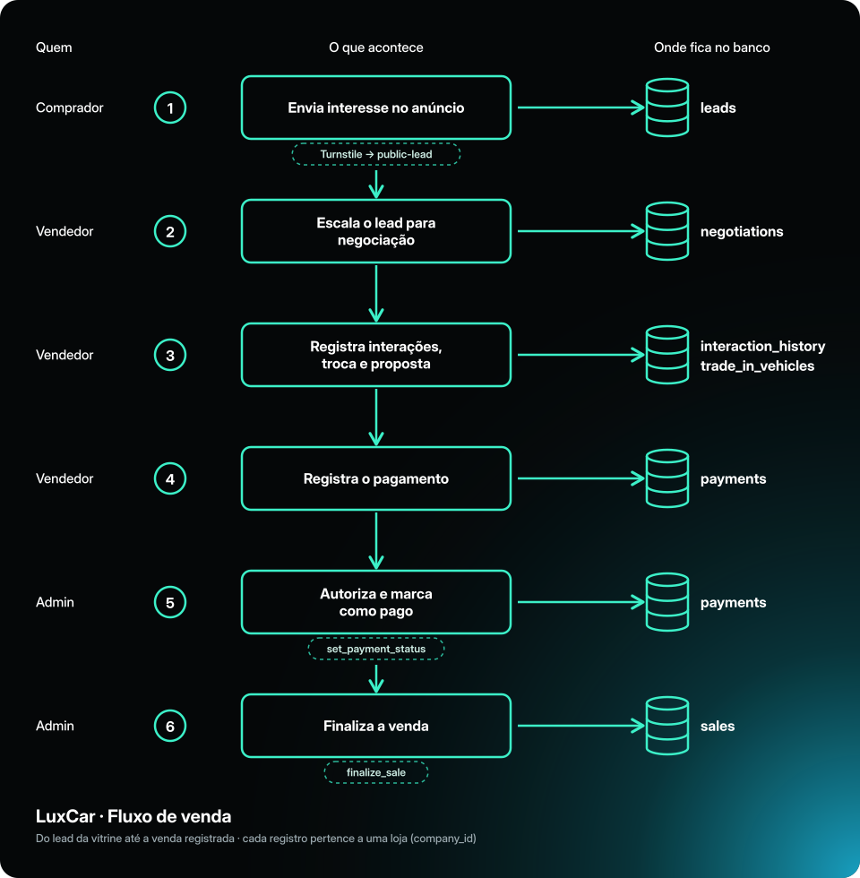
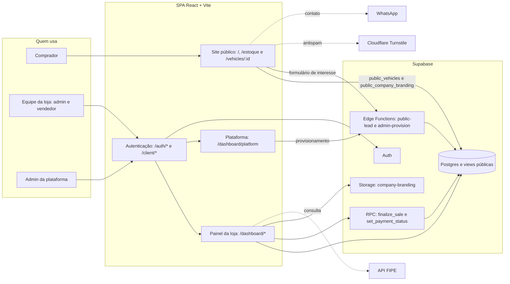
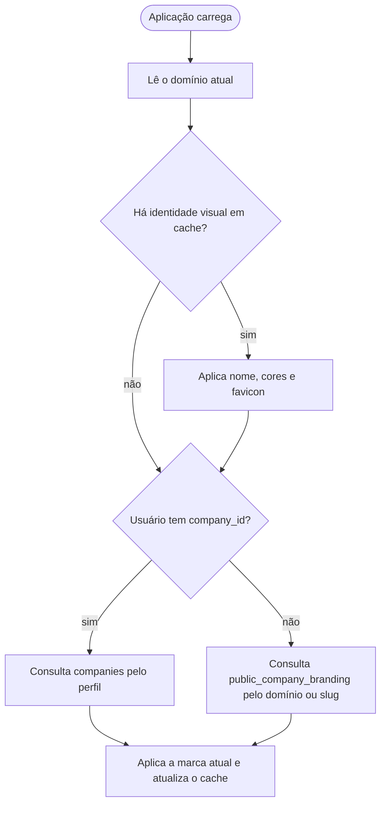
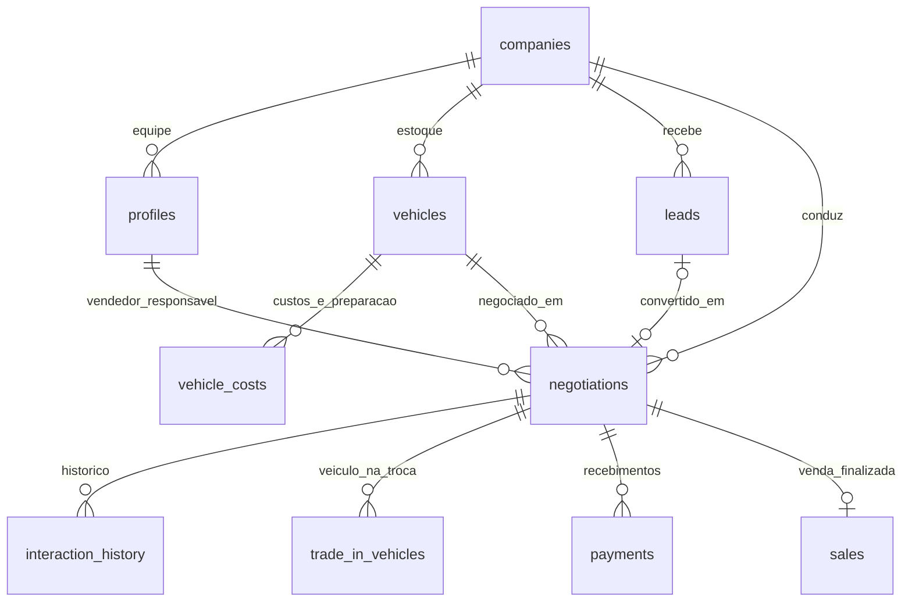
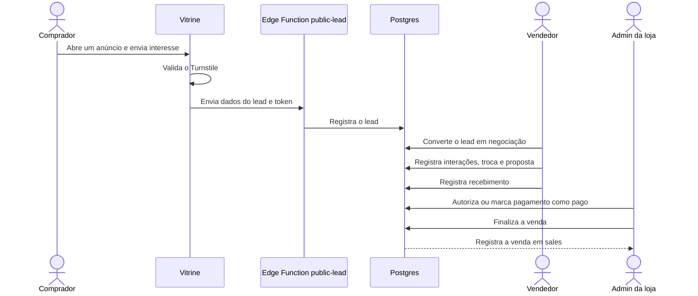

# LuxCar

[](https://github.com/Junior0481/luxcar/actions/workflows/ci.yml)

> **LuxCar é uma plataforma de gestão para concessionárias e lojas de veículos.** Reúne estoque, custos, leads, negociações, pagamentos, vendas e uma vitrine digital personalizável por loja.

**Acesse a aplicação:** [luxcar-six.vercel.app](https://luxcar-six.vercel.app)

O produto foi pensado para a operação diária de uma concessionária: o cliente encontra veículos na vitrine pública, a equipe acompanha o atendimento no painel e a gestão consulta os resultados comerciais. Cada loja pode configurar a própria identidade visual e administra seus dados em um espaço isolado.

## Sumário

- [Sobre o projeto](#sobre-o-projeto)
- [Objetivos](#objetivos)
- [Funcionalidades](#funcionalidades)
- [Tecnologias utilizadas](#tecnologias-utilizadas)
- [Arquitetura](#arquitetura)
- [Arquitetura técnica detalhada](#arquitetura-técnica-detalhada)
- [Estrutura do repositório](#estrutura-do-repositório)
- [Pré-requisitos](#pré-requisitos)
- [Instalação e execução](#instalação-e-execução)
- [Scripts disponíveis](#scripts-disponíveis)
- [Principais rotas](#principais-rotas)
- [Fluxo de desenvolvimento](#fluxo-de-desenvolvimento)
- [Arquitetura white label](#arquitetura-white-label)
- [Processo de deploy](#processo-de-deploy)
- [Banco de dados e segurança](#banco-de-dados-e-segurança)
- [Documentação acadêmica](#documentação-acadêmica)
- [Status do projeto](#status-do-projeto)
- [Autoria](#autoria)
- [Licença](#licença)

Sistema web para gestão de concessionárias e lojas de veículos, desenvolvido como projeto acadêmico. A aplicação centraliza o controle de estoque, custos, negociações, leads e indicadores comerciais, além de disponibilizar uma vitrine pública para consulta dos veículos cadastrados.

## Sobre o projeto

A LuxCar foi concebida para reduzir a dependência de planilhas e informações dispersas na rotina de uma loja automotiva. O sistema oferece uma interface pública para clientes e um ambiente interno para a equipe comercial, mantendo os dados integrados em uma única plataforma.

O projeto demonstra, na prática, conceitos de desenvolvimento de aplicações web, autenticação, controle de acesso, banco de dados relacional, integração com serviços externos e organização de uma aplicação em camadas.

## Objetivos

- Centralizar o cadastro e o acompanhamento dos veículos em estoque.
- Registrar custos, manutenções e informações financeiras de cada veículo.
- Organizar negociações e interações realizadas com clientes.
- Disponibilizar indicadores para apoiar decisões comerciais.
- Oferecer uma vitrine digital com os veículos disponíveis.
- Aplicar autenticação e regras de acesso aos dados da aplicação.

## Funcionalidades

### Ambiente público

- Apresentação institucional da plataforma.
- Consulta e filtragem dos veículos em estoque.
- Visualização dos detalhes de cada veículo.
- Cadastro e autenticação de clientes.
- Registro de interesse por meio de leads.

### Ambiente administrativo

- Autenticação de usuários internos.
- Dashboard com indicadores operacionais e comerciais.
- Cadastro, edição, consulta e exclusão de veículos.
- Controle de status do estoque.
- Registro de custos e manutenções.
- Acompanhamento das etapas de uma negociação.
- Histórico de interações com clientes.
- Registro de veículos recebidos como parte do pagamento.
- Relatórios de vendas e desempenho.
- Consulta de valores de referência por meio da API FIPE.

## Tecnologias utilizadas

| Tecnologia | Finalidade |
| --- | --- |
| React 18 | Construção da interface de usuário |
| TypeScript | Tipagem estática e maior segurança no desenvolvimento |
| Vite | Ambiente de desenvolvimento e geração da versão de produção |
| React Router | Definição e controle das rotas da aplicação |
| Tailwind CSS | Estilização e responsividade |
| Radix UI e Material UI | Componentes acessíveis e elementos de interface |
| Supabase | Autenticação, banco de dados PostgreSQL e armazenamento |
| Recharts | Visualização de indicadores e relatórios |
| API FIPE | Consulta de valores de referência de veículos |

## Arquitetura

A aplicação utiliza uma arquitetura cliente-servidor baseada em serviços:

```text
Usuário
   |
   v
Interface React
   |
   v
Camada de serviços
   |-------------------|
   v                   v
Supabase            API FIPE
Auth + PostgreSQL   Valores de referência
```

No frontend, as páginas e os componentes são responsáveis pela apresentação e pela interação com o usuário. A camada de serviços concentra o acesso aos dados. O Supabase fornece autenticação e persistência em PostgreSQL, com políticas de segurança em nível de linha (RLS).

## Arquitetura técnica detalhada

O LuxCar é uma SPA em React com Vite que se conecta diretamente ao Supabase. A aplicação não mantém um servidor de API próprio: autenticação, PostgreSQL, funções RPC, Edge Functions e Storage são fornecidos pelo Supabase. Cada concessionária funciona como um tenant identificado por `company_id`.

### Diagramas





### Usuários, aplicação e serviços



### Aplicação da identidade white label

Ao carregar a aplicação, o domínio e a sessão determinam a origem da marca. Usuários autenticados consultam a empresa associada ao perfil; visitantes usam a configuração pública do domínio ou do identificador da loja. A marca em cache é aplicada de imediato e atualizada após a consulta.



### Modelo de dados principal



`public_vehicles` e `public_company_branding` são as fontes de leitura do site público. `subscription_requests` registra solicitações de assinatura enviadas pelo formulário público.

### Jornada de venda



## Estrutura do repositório

```text
luxcar/
├── src/
│   ├── app/
│   │   ├── components/     # Componentes e layouts da interface
│   │   ├── pages/          # Páginas públicas e administrativas
│   │   └── routes.tsx      # Configuração das rotas
│   ├── contexts/           # Estado global de autenticação
│   ├── hooks/              # Hooks reutilizáveis
│   ├── lib/                # Cliente Supabase e utilitários
│   ├── services/           # Regras de acesso e manipulação de dados
│   └── styles/             # Estilos globais e tema
├── DOCUMENTACAO_ACADEMICA.md # Especificação acadêmica do sistema
├── MODELO_FISICO_COMPLETO.sql # Modelo físico consolidado do banco
├── SETUP_GUIDE.md            # Guia complementar de configuração
└── supabase-*.sql            # Schema, migrações e ajustes do Supabase
```

## Pré-requisitos

- Node.js 18 ou superior.
- pnpm instalado.
- Projeto criado no Supabase.
- URL e chave anônima do projeto Supabase.

## Instalação e execução

1. Clone o repositório:

```bash
git clone https://github.com/Junior0481/luxcar.git
cd luxcar
```

2. Instale as dependências:

```bash
pnpm install
```

3. Crie o arquivo local de variáveis de ambiente:

```bash
cp .env.example .env
```

No Windows PowerShell, utilize:

```powershell
Copy-Item .env.example .env
```

4. Preencha as credenciais no arquivo `.env`:

```env
VITE_SUPABASE_URL=https://seu-projeto.supabase.co
VITE_SUPABASE_ANON_KEY=sua-chave-anonima
VITE_DEFAULT_COMPANY_SLUG=luxcar
```

5. No SQL Editor do Supabase, execute `MODELO_FISICO_COMPLETO.sql` em uma instalação nova. Em um banco existente, aplique as migrações versionadas em ordem. As migrações incluem isolamento multitenant, identidade visual, pagamentos, relacionamento cliente-loja, políticas RLS e solicitações de assinatura.

6. Inicie o servidor de desenvolvimento:

```bash
pnpm dev
```

A aplicação ficará disponível, por padrão, em `http://localhost:5173`.

## Scripts disponíveis

| Comando | Descrição |
| --- | --- |
| `pnpm dev` | Inicia o ambiente local de desenvolvimento |
| `pnpm build` | Gera a versão otimizada para produção |
| `pnpm test` | Executa os testes unitários e de integração |
| `pnpm test:coverage` | Gera o relatório de cobertura |
| `pnpm test:e2e` | Executa os fluxos E2E com Playwright |
| `pnpm test:e2e:headed` | Executa a jornada desktop com o navegador visível |
| `pnpm test:e2e:ui` | Abre a interface interativa do Playwright |
| `pnpm test:e2e:report` | Abre o último relatório HTML |
| `pnpm check` | Valida tipos, testes e build de produção |

### Migrar fotos antigas para o Supabase Storage

O script `scripts/migrate-images-to-storage.mjs` substitui imagens `data:` já salvas em `vehicles.images` e `trade_in_vehicles.images` por URLs do bucket público `vehicles`. Ele gera os arquivos WebP grande e miniatura e ignora imagens que já não estejam em base64.

Defina as credenciais apenas no ambiente do terminal. A chave `SUPABASE_SERVICE_ROLE_KEY` é privilegiada: não a coloque no README, em arquivos versionados ou em variáveis `VITE_*`.

```powershell
$env:SUPABASE_URL = "https://seu-projeto.supabase.co"
$env:SUPABASE_SERVICE_ROLE_KEY = "<chave service_role obtida no painel Supabase>"
pnpm exec node scripts/migrate-images-to-storage.mjs --dry-run
pnpm exec node scripts/migrate-images-to-storage.mjs
Remove-Item Env:SUPABASE_URL
Remove-Item Env:SUPABASE_SERVICE_ROLE_KEY
```

Revise a lista do `--dry-run` antes da execução real. Sem essa opção, o script envia os arquivos ao Storage e atualiza os arrays `images` no banco. A ferramenta lê somente as variáveis de ambiente do processo; não carrega credenciais de arquivos.

### Validação navegável com Playwright

Os testes percorrem a vitrine pública em desktop e celular, monitoram erros de
JavaScript e validam as permissões de administrador, vendedor e cliente. Para
habilitar as jornadas autenticadas, configure no `.env` local as variáveis
`E2E_ADMIN_EMAIL`, `E2E_ADMIN_PASSWORD`, `E2E_SELLER_EMAIL`,
`E2E_SELLER_PASSWORD`, `E2E_CLIENT_EMAIL` e `E2E_CLIENT_PASSWORD`.

Por padrão, o Playwright compila e abre a aplicação localmente. Para testar o
deploy, informe também:

```env
E2E_BASE_URL=https://luxcar-six.vercel.app
```

Em caso de falha, ficam disponíveis relatório HTML, screenshot, vídeo e trace
de navegação. As credenciais E2E devem pertencer apenas a contas de teste e não
devem ser commitadas.

A suíte `full-lifecycle.spec.ts` valida o ciclo white label completo: criação
da empresa e do primeiro administrador, personalização das cores, cadastro de
vendedor, veículo, negociação, avanço das etapas, pagamento e fechamento da
venda. Por criar dados reais, ela só executa quando
`E2E_ALLOW_MUTATIONS=true` e as credenciais `E2E_PLATFORM_*` estiverem
configuradas.

## Principais rotas

| Rota | Descrição |
| --- | --- |
| `/` | Apresentação da plataforma |
| `/estoque` | Vitrine pública de veículos |
| `/vehicles/:id` | Detalhes públicos de um veículo |
| `/auth/login` | Acesso de usuários internos |
| `/auth/forgot-password` | Solicitação de link de recuperação de senha |
| `/auth/update-password` | Definição de nova senha após confirmar o link enviado por email |
| `/client/login` | Acesso de clientes |
| `/dashboard` | Painel administrativo |
| `/dashboard/vehicles` | Gestão do estoque |
| `/dashboard/negotiations` | Gestão das negociações |
| `/dashboard/payments` | Pagamentos vinculados às negociações |
| `/dashboard/team` | Administração dos acessos da empresa |
| `/dashboard/platform` | Provisionamento de empresas pelo administrador da plataforma |
| `/dashboard/reports` | Relatórios gerenciais |

## Fluxo de desenvolvimento

O cadastro público recebe uma solicitação da assinatura completa. O administrador da plataforma confere o pagamento em `/dashboard/platform`, escolhe uma senha temporária e provisiona a concessionária e o admin inicial. As credenciais são exibidas ao operador para entrega manual ao proprietário; configure um canal seguro antes de automatizar esse envio.

1. Crie uma branch a partir da `main`.
2. Implemente a alteração mantendo todas as consultas internas escopadas por `company_id`.
3. Para mudanças no banco, adicione uma migração SQL versionada e revise as políticas RLS.
4. Execute `pnpm check` antes de criar o commit.
5. Abra um pull request descrevendo impacto, testes e eventual procedimento de migração.

Nunca utilize `service_role` no frontend. Essa chave é exclusiva de rotinas administrativas executadas em ambiente seguro.

## Arquitetura white label

Cada empresa é um tenant independente. Usuários internos, veículos, negociações, vendas, pagamentos e relatórios são associados por `company_id`. O isolamento é aplicado simultaneamente na aplicação e nas políticas RLS do PostgreSQL.

Nome, logotipo, cores, favicon e domínio podem ser configurados por empresa. Clientes finais permanecem separados dos usuários internos e podem se relacionar com diversas lojas por meio de `customer_companies`.

## Processo de deploy

O projeto possui configuração para deploy na Vercel:

1. Configure `VITE_SUPABASE_URL`, `VITE_SUPABASE_ANON_KEY` e `VITE_DEFAULT_COMPANY_SLUG` nas variáveis do projeto.
2. Aplique e valide previamente as migrações no Supabase.
3. Execute `pnpm check` localmente ou no pipeline de CI.
4. Publique a branch e valide o preview da Vercel.
5. Faça merge na `main` somente após os testes; a Vercel produzirá o deploy de produção.

Para domínios white label, cadastre o domínio na Vercel e preencha `custom_domain` na empresa correspondente.

## Banco de dados e segurança

O modelo de dados contempla entidades como perfis, lojas, veículos, custos, leads, negociações, interações e vendas. A segurança é apoiada pelos seguintes recursos:

- autenticação gerenciada pelo Supabase Auth;
- uso de JSON Web Tokens (JWT) nas sessões autenticadas;
- políticas de Row Level Security (RLS);
- separação entre as áreas pública e administrativa;
- validação de dados na camada de serviços.

As chaves privadas do ambiente não devem ser adicionadas ao controle de versão. O arquivo `.env.example` deve conter somente os nomes das variáveis necessárias.

## Documentação acadêmica

O arquivo [`DOCUMENTACAO_ACADEMICA.md`](DOCUMENTACAO_ACADEMICA.md) apresenta detalhes adicionais do trabalho, incluindo:

- atores e casos de uso;
- diagramas de caso de uso e de classes;
- wireframes das principais interfaces;
- modelagem do banco de dados;
- modelo entidade-relacionamento;
- arquitetura da aplicação;
- considerações de acessibilidade.

## Status do projeto

Projeto acadêmico em desenvolvimento. Algumas funcionalidades e regras de negócio podem passar por ajustes conforme a evolução dos requisitos e a validação dos testes.

O produto está estruturado como uma plataforma SaaS white label: uma assinatura completa reúne os recursos essenciais e profissionais, e cada concessionária recebe sua própria operação, equipe e vitrine personalizada.

## Autoria

Projeto desenvolvido para fins acadêmicos. Consulte o histórico do repositório para informações sobre autoria e contribuições.

## Licença

Este repositório está disponível sob a [licença MIT](LICENSE).
